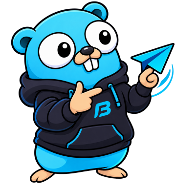

<p align="center">
  
</p>

<h1 align="center">Bikasend</h1>

<p align="center">
  <strong>Send requests straight from your Swagger docs.</strong><br>
  A lightweight desktop API client for services that already document themselves.
</p>

<p align="center">
  <a href="go.mod"></a>
  <a href="https://wails.io"></a>
  
  
  <a href=".github/workflows/release.yml"></a>
  <br>
  
  <a href=".github/dependabot.yml"></a>
  <a href=".agents/rules/10-security.md"></a>
  
  
  <a href="LICENSE"></a>
</p>

---

Bikasend opens a repo of services, finds every `swagger.json` and
`openapi.json` in it, and turns each operation into a ready-to-send request. There are no
collections to build, no accounts and no sync. It's like Postman or Bruno without the parts we
don't use.

## Features

- **Open a folder, get every endpoint.** Scans the repo for Swagger and OpenAPI files, grouped by
  tag. It skips `.git`, `node_modules` and `vendor`, and reloads when a spec changes.
- **Swagger 2.0 and OpenAPI 3.0 / 3.1**, JSON or YAML, with `$ref` across files and server
  variables.
- **Bodies pre-filled** from the schema's examples, enums and defaults. Path and query
  parameters get their own form. JSON, text, XML, form and multipart (file upload) bodies.
- **`{{variables}}` everywhere**, highlighted as you type, with autocomplete.
- **Environments and shared variables.** A committed `bikasend.json` holds environments (local,
  staging…) and variable definitions for the whole team. Your own `globals.json` holds personal
  ones.
- **AWS secrets, loaded into memory.** Reference AWS Secrets Manager or Parameter Store values.
  Bikasend loads them through your own `aws` CLI and SSO login. Nothing secret is ever committed.
- **Auth helpers.** OAuth2 client credentials and AWS SigV4 signing per environment.
- **Responses that explain themselves.** JSON tree, search, timing breakdown, image preview, and
  a check against the spec's response schema.
- **History, tabs, command palette (`⌘K`), cURL import and export** (secrets become `$ENV`
  references).
- **Secrets stay in memory.** Never written to disk, logs or the web view. Blocked from hosts an
  environment doesn't list unless you confirm the host, from plain http, and from redirects to
  another host or to plain http.
- **No CORS.** Requests run natively from Go, not from a browser.
- **Small.** About 10 MB, uses the system web view, works offline.

## Variables, environments and AWS

Write `{{name}}` anywhere in a request. Values come from four scopes, the narrowest first:

| Scope | Lives in | Shared? |
| --- | --- | --- |
| Session | memory, gone when you quit | no |
| Environment | `bikasend.json` → `environments.<name>.variables` | yes, through git |
| Folder | `bikasend.json` → `variables` | yes, through git |
| Global | your own `globals.json` (Bikasend's config folder) | no |

`{{baseUrl}}` falls back to the spec's server. A committed `bikasend.json` looks like this:

```json
{
  "variables": { "tenant": "demo" },
  "environments": {
    "local": {
      "hosts": ["localhost"],
      "variables": {
        "baseUrl": "http://localhost:8080",
        "X-API-Key": { "prompt": "Local API key" }
      }
    },
    "staging": {
      "hosts": ["*.staging.example.com"],
      "aws": { "profile": "staging", "region": "eu-west-1" },
      "variables": {
        "baseUrl": "https://api.staging.example.com",
        "X-API-Key": { "aws": "example-service/api-keys", "key": "bikasend" }
      }
    }
  }
}
```

The team shares where a secret lives, never the secret itself. Each person loads it with their own
AWS login (`aws sso login`, which Bikasend can start for you). Values are: a plain string,
`{"prompt": "…"}` (asked once per session), `{"aws": "<secret id>", "key": "<json key>"}`,
`{"ssm": "<parameter>"}` or `{"env": "<VARIABLE>"}`. Environments can also set `timeoutSeconds`,
`followRedirects`, `tls` (CA and client certificate files in the repo), `oauth2` and `sigv4`.

Bikasend ignores a folder's `bikasend.json` until you trust it, and asks again whenever it changes.
Secrets are only sent to the hosts the environment lists. Any other host needs your confirmation on
each send (loopback is exempt), and `oauth2` needs a `hosts` list. Press `⌘E` to edit variables.

## Download

Get the latest build from the **Bikasend download site** or from this repo's
[Releases](../../releases). Every build comes from CI and has a SHA-256 checksum.

| Platform | File | Needs |
| --- | --- | --- |
| macOS 13+ (Apple silicon and Intel) | `Bikasend-<tag>-macos-universal.zip` | — |
| Windows 10/11, 64-bit | `Bikasend-<tag>-windows-amd64.zip` | WebView2 runtime (built into Windows 11) |
| Linux, 64-bit | `Bikasend-<tag>-linux-amd64.zip` | `libgtk-3-0`, `libwebkit2gtk-4.1-0` |

Builds are not signed yet. On macOS, open the app once, then go to **System Settings → Privacy &
Security → Open Anyway**. On Windows, choose **More info → Run anyway**.

## Development

```sh
brew install go
go install github.com/wailsapp/wails/v2/cmd/wails@v2.17.1
wails doctor
```

| Task | Command |
| --- | --- |
| Run the app | `make run` |
| Run the app with live reload | `make dev` |
| Test | `make test` |
| Vet, lint, architecture rules | `make vet`, `make lint`, `make arch_lint` |
| Fuzz the spec parsers | `make fuzz` |
| Security scan (govulncheck + gosec) | `make security` |
| Build the app for this OS | `make app` → `build/bikasend/bin/` |
| Run the download site | `make site` → <http://localhost:8091> |
| Quick public URL for the site | `make tunnel` |

The only third-party Go module is Wails. Everything else is the standard library: no npm, no
frontend framework, no CDN.

## Project layout

```tree
cmd/bikasend/        Desktop app wiring + wails.json
cmd/site/            Download site wiring
internal/bikasend/   api (Wails bindings), core (scan, parse, variables, send), frontend
internal/site/       api (pages, feed, latest.json, downloads), core (cached GitHub releases)
pkg/sdk/             Service contracts: port.go, types.go, errors.go
pkg/awscli/          Runs your aws CLI: secrets, parameters, credentials, SSO login
pkg/sigv4/           AWS Signature V4, stdlib only
pkg/github/          GitHub Releases client
pkg/httpserve/       Stdlib router and rate limiter
docs/                Threat model
build/               App icon, Wails platform files, site Dockerfile
deploy/site/         docker-compose: site + Cloudflare tunnel
.agents/             Rules, skills and agents for AI coding tools
```

## Releasing

```sh
git tag v0.2.0
git push origin v0.2.0
```

[`release.yml`](.github/workflows/release.yml) builds macOS, Windows and Linux on native
runners and publishes a GitHub release with generated notes. The download site picks it up
within 5 minutes.

Before tagging, check that the site still describes the app correctly
([`90-website-audit.md`](.agents/rules/90-website-audit.md)).

## Download site

The site lists the newest releases from GitHub and redirects each download to GitHub's
short-lived signed URL. It never stores or streams files.

```sh
TUNNEL_TOKEN=… GITHUB_TOKEN=… docker compose -f deploy/site/docker-compose.yml up -d --build
```

- `GITHUB_TOKEN`: a fine-grained token with read-only **Contents** on this repo only. Not needed
  if the repo is public.
- `TUNNEL_TOKEN`: from the Cloudflare tunnel. Route its public hostname to `http://site:8091`.

The container is read-only, runs as a non-root user with no capabilities, and has memory, CPU,
process and log-size limits. It publishes no ports: only the tunnel can reach it.

The site limits each client, caps concurrent requests, times out slow clients and backs off when
GitHub is down. Cloudflare stops floods before they reach the tunnel. Set these in its dashboard:

- **SSL/TLS:** Full mode, Always Use HTTPS, HSTS, minimum TLS 1.2.
- **Security:** the free managed WAF ruleset on. Leave Bot Fight Mode off: it challenges the app's
  update check and feed readers, and the free plan cannot exempt a path from it.
- **WAF custom rule:** block every method except `GET` and `HEAD`.
- **Rate limiting rule:** `/downloads/` at about 20 requests per 10 seconds per IP, block for 10 seconds.
- **Tunnel:** one public hostname to `http://site:8091`, and a catch-all rule that returns 404.
- **DNS:** DNSSEC on.
- **During an attack:** turn on Under Attack mode.

## Security

Security comes first in this repo. Read [`10-security.md`](.agents/rules/10-security.md) before
you change anything. In short:

- read the [threat model](docs/threat-model.md) before you change a trust boundary,
- run `make security` and the `security-auditor` agent before every PR; CI scans every PR and a
  monthly audit opens an issue when something new turns up,
- secrets live in memory or in environment variables, never in files or logs,
- untrusted text (Swagger files, responses, release notes) is always rendered as text,
- GitHub Actions are pinned to commit SHAs, and Dependabot keeps them and Go up to date.

## Roadmap

Planned work lives in [ROADMAP.md](ROADMAP.md). Next up: distribution (code signing,
notarisation and installers).

## Contributing

Read [`.agents/AGENTS.md`](.agents/AGENTS.md) and the rules in [`.agents/rules/`](.agents/rules/).
They apply to people and AI tools alike. Fill in every section of the
[PR template](.github/pull_request_template.md), including Security and Website.

## Credits

- Made by **Plaasbotter** at **BikaSolutions**.
- The Go gopher was designed by [Renée French](https://reneefrench.blogspot.com/) and is licensed
  under [CC BY 4.0](https://creativecommons.org/licenses/by/4.0/). The Bikasend mascot is based
  on it.
- [Open Sans](https://fonts.google.com/specimen/Open+Sans) © The Open Sans Project Authors,
  licensed under the [SIL Open Font License 1.1](internal/site/api/static/OFL-OpenSans.txt). It's
  free to use, change and ship.
- The paper-plane app icon and favicon are original to Bikasend.
- Built with [Wails](https://wails.io).

## Licence

Bikasend is free and open source under the [MIT licence](LICENSE), © 2026 BikaSolutions. The
Open Sans font and the gopher artwork keep their own licences (see Credits).
